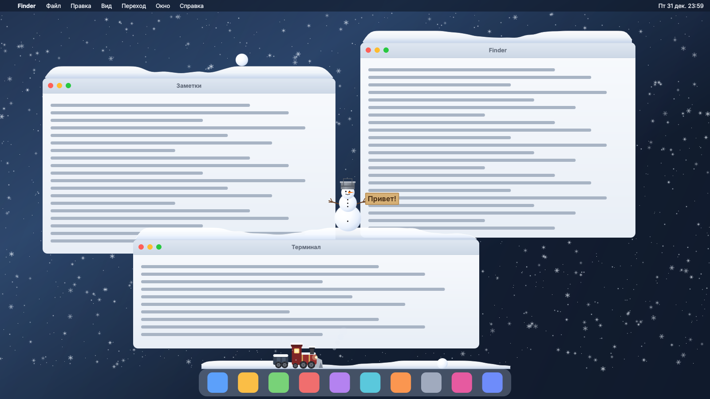

# Flake для macOS

Снег на рабочем столе Mac: снегопад поверх окон, сугробы на кромках окон и на
Dock, снежки, снеговики и паровозик, который чистит Dock. Порт
[Flake для Windows](https://github.com/nexttoo/flake-win) (nexttoo) обратно на
macOS — со всеми его добавками: паровозиком, музыкой и новогодними обоями.



## Скачать

Готовые сборки делает GitHub Actions (workflow **Build macOS app**):

- `Flake-macOS-arm64.zip` — для Mac на Apple Silicon (M1–M4);
- `Flake-macOS-x86_64.zip` — для Mac на Intel.

Их можно взять во вкладке **Actions** → последний запуск → **Artifacts**,
а при пуше тега `v*` (например, `v1.0.0`) они автоматически прикрепляются к
странице **Releases**.

## Установка

1. Распакуйте zip и перетащите **Flake.app** в «Программы» (`/Applications`).
2. Приложение не подписано сертификатом Apple, поэтому при первом запуске:
   правый клик по Flake.app → **Открыть** → **Открыть**.
   Если macOS пишет, что приложение «повреждено», выполните в Терминале:
   ```bash
   xattr -dr com.apple.quarantine /Applications/Flake.app
   ```
3. В строке меню появится снежинка, на экране пойдёт снег. Клик по снежинке —
   меню.

Никаких разрешений («Запись экрана», «Универсальный доступ») не нужно: Flake
читает только положение окон, а не их содержимое.

## Что умеет

- **Снегопад** поверх всех окон и на всех рабочих столах (Spaces): снежинки-
  кристаллы разного размера, ветер, порывы, покачивание.
- **Сугробы** растут на верхних кромках окон и на Dock. Учитываются скруглённые
  углы окон, слишком крутые склоны осыпаются.
- **Мышь**: проведите по сугробу — останется борозда. Зажмите кнопку и
  покатайте по сугробу — слепится снежок. Отпустите с размахом — снежок летит,
  отскакивает от окон и ложится на кромки.
- **Снеговик**: три снежка друг на друге превращаются в снеговика с морковкой,
  угольками и ведром. Его можно перетащить, он сам кидает снежки, из которых
  рождаются новые снеговики (до 8). Поставленный вручную — «шеф», не тает;
  остальные живут 3–5 минут.
- **Паровозик**: когда на Dock накопился снег, выезжает локомотив с отвалом и
  дымом, проходит весь Dock и счищает сугроб. Под уборку играет мелодия.
- **Новогодние обои**: две фотографии, две нарисованные сцены и свои картинки.
  Ставятся на все мониторы, прежние возвращаются одной кнопкой.
- **Табличка**: правый клик по снеговику — текст на табличке.
- **Растаять всё** — убрать снег с экрана.

Оверлей прозрачен для мыши, не появляется в Dock и в Cmd+Tab — работать он не
мешает.

## Меню (клик по снежинке в строке меню)

| Пункт | Что делает |
| --- | --- |
| Пауза / Продолжить | Останавливает снег, не закрывая приложение |
| Интенсивность → Мало / Средне / Много / Метель | Густота снега: ~700 / 1400 / 2000 / 2800 снежинок |
| Мышь: вкл / выкл | Взаимодействие с сугробами и снежками |
| Растаять всё | Мгновенно убирает снег |
| Снеговик (поставить) | Ставит снеговика на кромку самого широкого окна |
| Убрать снеговиков | Убирает всех снеговиков |
| Паровозик → Пустить сейчас / Катается сам | Ручной или автоматический рейс по Dock |
| Паровозик → Музыка под уборку / Громкость | Мелодия во время уборки, 30 / 60 / 90 % |
| Новогодние обои → … | Готовые фото, рисованные сцены, свои картинки, «Вернуть прежние» |
| Скрывать снег над развёрнутыми окнами | По умолчанию выключено |
| Открывать при входе в систему | Автозапуск через LaunchAgent (`~/Library/LaunchAgents/io.github.flakemac.plist`) |
| О программе / Выход | — |

## Настройки и файлы

- Настройки: `~/Library/Application Support/FlakeMac/settings.json`
  (тот же формат, что у Windows-версии; `snowman_scale` — размер снеговика).
- Свои обои: `~/Library/Application Support/FlakeMac/wallpaper/custom/`
  (`jpg`, `jpeg`, `png`, `bmp`, `webp`) — или «Добавить из файла…» в меню.

## Сборка из исходников

Нужен Mac и Python 3.10+ (лучше 3.12 с python.org или Homebrew).

```bash
./build.sh
```

Скрипт создаст `.venv`, поставит зависимости (`PySide6-Essentials`, `numpy`,
`pyobjc`, `pyinstaller`, `pillow`), сгенерирует иконку и соберёт
`dist/Flake.app` и `dist/Flake-macOS.zip`. Сборка получается под архитектуру
вашего Mac.

Запуск без сборки:

```bash
python3 -m pip install -r requirements.txt
python3 run_flake.py
```

Проверки (работают и без экрана, в том числе на Linux):

```bash
QT_QPA_PLATFORM=offscreen python3 check_sim.py              # физика, снеговики, паровозик
QT_QPA_PLATFORM=offscreen python3 run_flake.py --selftest preview.png   # офлайн-рендер кадра и обоев
```

## Как устроено

| Файл | Назначение |
| --- | --- |
| `flakemac/macapi.py` | macOS: окна (Quartz `CGWindowList`), экраны, Dock, курсор и кнопки мыши, настройка окна-оверлея, обои (`NSWorkspace`) |
| `flakemac/world.py` | Экраны и масштаб Retina |
| `flakemac/tracker.py` | Какие окна дают сугроб, что непроницаемо, где прятать снег |
| `flakemac/drifts.py` | Карта высот сугроба: наметание, осыпание, разгребание |
| `flakemac/sim.py` | Снежинки (numpy), снежки, снеговики, мышь |
| `flakemac/train.py` | Паровозик: маршрут, дым, расчистка Dock |
| `flakemac/audio.py` | Музыка паровозика через `NSSound` с плавным входом/затуханием |
| `flakemac/wallpaper.py` | Рисованные обои и их установка |
| `flakemac/render.py` | Отрисовка QPainter: кристаллы, сугробы, снеговик, поезд |
| `flakemac/overlay.py` | Прозрачные окна на каждый монитор и цикл кадров |
| `flakemac/app.py` | Значок в строке меню, меню, диалоги, автозапуск |

Физика, рендер и обои взяты из Windows-версии без изменений; переписан только
платформенный слой (`winapi.py` → `macapi.py`, аудио, автозапуск, единственный
экземпляр, пути).

## Отличия от Windows-версии

- Вместо панели задач — **Dock**. Снег копится, только когда Dock внизу экрана и
  не скрывается автоматически. Если точную ширину Dock определить не удалось,
  сугроб лежит по всей ширине экрана над Dock.
- Окно-оверлей видно на всех рабочих столах (Spaces) и поверх полноэкранных
  приложений; полноэкранное окно считается «развёрнутым».
- Клик по снежинке открывает меню (на Windows левый клик ставил паузу) — пауза
  первым пунктом меню.
- Плавающие окна (уровень выше обычного) снег не накапливают — как и
  topmost-окна в Windows-версии.

## Лицензия и авторство

Код — MIT (см. [LICENSE](LICENSE)). Основа — **Flake для Windows** от
[nexttoo](https://github.com/nexttoo/flake-win); порт на macOS — в этом
репозитории.

Идея, поведение и название **Flake** принадлежат Артуру Тонояну —
[ArturTonoyan/flake](https://github.com/ArturTonoyan/flake) (оригинальное
приложение для macOS на Swift + Metal). Все права на оригинальное приложение
остаются у его автора.

Мелодия «Merry Christmas» — AtlasAudio (royalty-free). Фотографии обоев «Зимняя
ночь» и «Зимнее утро» взяты из репозитория Flake для Windows.
